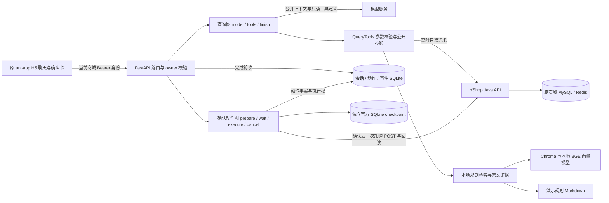
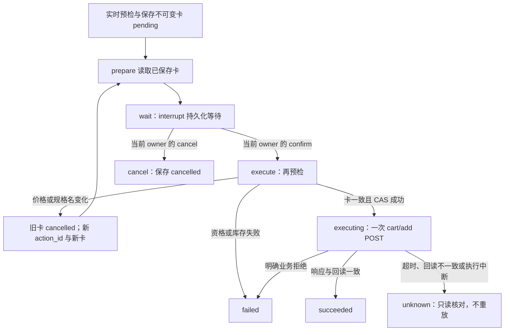

# YShop Agent：实际架构与工程边界

本文按 2026-10-31 可见源码编写，说明基于 YShop 二次开发的商城 Agent。它把商品查询、演示规则检索、多轮指代和明确确认后的加购接入原 uni-app H5；订单、支付与原商城业务仍由 YShop 承担。这里的 Agent 是一个受约束的应用编排，不是多 Agent 产品。

适合面试时先说明业务闭环，再按“模型能决定什么、数据从哪里来、写操作由谁授权、失败后如何恢复”展开。本文核验的是源码和文档引用；历史测试成绩与当前运行状态另行区分。

## 1. 组件与数据边界

可独立打开并放大查看：[组件图 SVG](../../output/day10/diagrams/components.svg)。图由下方同一段 Mermaid 源码渲染。

Python 不直接修改商城数据库，商品与购物车通过 Java API 访问；RAG 只读本地演示规则。商城 Authorization、模型 API key 与工具执行器留在请求对象或闭包中，不作为图状态、会话正文或检查点数据持久化。数据库中的 `user_id` 是所有权字段，和公开会话快照分开。

入口见 [API 路由](../../yshop-agent/app/api/routes.py)、[依赖装配](../../yshop-agent/app/main.py) 与 [H5 聊天页](../../yshop-mall-uniapp/pages/agent/Chat/index.vue)。业务查询、动作状态与规则资料分别有自己的事实来源，模型输出不覆盖它们。

## 2. 每次请求重新确认所有者

除健康检查外，这里的业务接口依赖 `require_identity`：要求单一且格式合法的 Authorization 头，再调用商城 `userinfo` 取得当前 `user_id`。继续会话、读取动作、读取历史和提交决定都重新验证身份。会话按 `session_id + user_id` 查询，动作还关联同一所有者的会话；猜到一个 ID 不会获得该记录的访问权。

模型请求使用独立 HTTP 客户端与模型凭据，商城请求只带本次商城身份。两者关闭环境代理隐式继承和重定向；模型代理由显式设置控制。工具中遇到身份失效会停止本轮，不再继续剩余工具或模型调用。可对应阅读 [身份依赖](../../yshop-agent/app/api/dependencies.py)、[会话所有权](../../yshop-agent/app/storage/sessions.py#L119)、[动作所有权](../../yshop-agent/app/storage/actions.py#L147) 与 [模型适配器](../../yshop-agent/app/agent/model.py#L156)。

H5 沿用已有商城登录，不把 Token 写入 Agent 会话缓存。用户切换、退出或 401 会使旧异步请求失效；缓存按已核验的商城用户区分。页面刷新恢复的是消息、会话/动作 ID 和提交锁，不能把本地缓存当作服务端授权或重新可执行的确认卡。实现见 [前端会话模块](../../yshop-mall-uniapp/utils/agent/conversation.mjs)。

## 3. 查询图：模型选择受限工具，服务生成公开结果

[QueryAgent](../../yshop-agent/app/agent/graph.py) 的实际节点为 `START → model → tools → model`，无工具调用或达到上限时进入 `finish → END`。这张图没有配置 checkpoint saver，每次聊天重新运行；跨轮状态由外层 ConversationAgent 和会话 SQLite 保存。

| 约束 | 实际行为 |
| --- | --- |
| 工具集合 | 只有 `search_products`、`get_product_detail`、`search_policy` 三个只读工具；模型看不到购物车写入工具 |
| 执行预算 | 最多 5 轮模型调用，一轮最多 3 个工具提案；工具顺序执行，末轮仍请求工具时直接返回 `limit_reached` |
| 工具参数 | Pydantic 模型、工具白名单、调用 ID/JSON 大小等共同校验；模型商品搜索固定 `limit=3` |
| 公开回答 | 商品说明与状态由服务组装，价格库存显示在工具结果商品卡；规则回答来自检索服务；模型自由文本不直接成为用户答案 |
| 无工具澄清 | 模型只能选择服务预置的有限澄清类别；无法借自由文本声称已经加购 |

代码上的工具能力边界由 [QueryTools](../../yshop-agent/app/agent/tools.py) 实施，提示词只是其中一层。[模型适配器](../../yshop-agent/app/agent/model.py) 使用兼容 `chat/completions` 的完整 JSON 响应，检查工具调用和 usage，并且没有模型请求自动重试循环。

[ConversationAgent](../../yshop-agent/app/agent/conversation.py) 在图外处理明确预算变化、换商品类型和“第一个/这个规格”等指代。改预算会重新查询；换类型清除旧分类和预算；商品指代必须重新读取详情；缺候选、序号越界或规格歧义时追问。送给模型的候选上下文只包含 ID、名称和规格名称，不包含历史价格库存。完成后的公开快照仍可保留最近商品卡，便于指代和展示，下一次业务操作不会用这份旧快照替代实时预检。

纯规则问题会先校验模型提出的参数，再使用当前用户原问题检索，避免改写成另一个政策问题。对于识别明确却漏选工具的问题，首轮已有控制逻辑可以补上必要调用；错误的其他工具提案仍会被拒绝。规则插问保留原商品选择，来源必须来自本轮检索。实现与 Day9 修复背景见 [评测说明](evaluation.md)。

## 4. 商品与规则各自如何成为依据

### 实时商品：按可购 SKU 过滤预算

Java 的新增只读查询 `GET /api/agent/products` 对商品要求在售、未删除、非积分兑换；SKU 要求库存大于 0、价格非负且规格标识有效。预算上下界包含端点，按 SKU 价格筛选：商品至少有一个匹配 SKU 才入选，返回时只带匹配规格，商品展示起价不参与预算判断。

计数、商品分页和匹配规格查询共用筛选条件，并处于只读 `REPEATABLE_READ` 事务中。Python 继续检查规格预算、库存、重复 ID、分页与 total 的一致性。聊天最多展示 3 件商品；独立查询 API 的页大小默认 10、最大 20，两种上限不能混为一谈。

源码见 [Java 筛选 SQL](../../yshop-mall-boot/yshop-mall/src/main/java/co/yixiang/modules/product/service/mapper/AgentProductMapper.java)、[Java 只读事务](../../yshop-mall-boot/yshop-mall/src/main/java/co/yixiang/modules/product/service/AgentProductSearchService.java) 和 [Python 商城适配器](../../yshop-agent/app/tools/yshop.py)。参数与历史验证见 [接入说明](integration.md)。直接详情读取和可购资格检查用途不同：准备/确认加购时还要用普通商品查询核验目标商品与 SKU，不能仅凭详情存在就准许写入。

### 演示规则：候选、句子证据与原文摘录

[PolicyStore](../../yshop-agent/app/rag/store.py) 使用本地向量、Chroma 和知识 Markdown。manifest 绑定语料、切分器、模型与索引代次；查询会核对当前知识、索引内容及向量结构。不一致时返回错误，不在聊天请求中静默重建。显式构建完整新代次后才原子替换 manifest。

代码使用 `BAAI/bge-small-zh-v1.5`，默认块长 500、重叠 50、`top_k=4`。候选分数由余弦距离转换，默认最低分为 **0.53**；随后 [evidence.py](../../yshop-agent/app/rag/evidence.py) 对原文句子算相似度，以 **0.5 × 块分数 + 0.5 × 最佳句子分数** 排序，最佳句子默认还须达到 **0.60**。阈值、top-k、块长与重叠量是 [RagSettings 中可配置的参数](../../yshop-agent/app/rag/config.py)；两个 **0.5** 权重则是 `evidence.py` 中的代码常量，不能通过这些配置覆盖。这里列出的是源码设定，不代表本次读取了运行环境的实际配置。

最终最多选择一个未经改写的原始知识块，句子仅用于证据筛选；[PolicyService](../../yshop-agent/app/rag/service.py) 返回整块原文摘录与来源。对于“资料未说明”等句子还有保守证据检查；不足时返回 `no_evidence` 和空来源，始终提示这是演示规则，不构成真实商城承诺。这条路径没有再让模型生成政策结论。

“引用逐字一致”只能证明摘录忠实，不能单独证明相关性、召回或排序正确。Day9 没有测原始 Recall@K/MRR，不能用公开来源数或引用一致率代替这些指标。

## 5. 加购图：真实中断、不可变确认与执行围栏

聊天入口先尝试 [保守加购意图解析](../../yshop-agent/app/actions/intent.py)：仅从当前用户消息和已知候选解析商品、规格与 1–9999 的整数数量。检索文本不能创建动作，否定、疑问或引用内容等不会直接授权加购。信息不足返回 `needs_input`；已有待确认动作时先返回该动作，不靠一句“确认”绕过决策 API。

可独立打开：[确认动作图 SVG](../../output/day10/diagrams/cart-action.svg)。

图中 `prepare/wait/execute/cancel` 是 [CartActionService 的真实 LangGraph 节点](../../yshop-agent/app/agent/cart_action.py#L95)。准备阶段先把动作卡与会话指针保存，再确保官方 saver 中确实存在 `wait` 中断；`Command(resume=...)` 必须来自当前请求通过校验的决定。请求身份、授权对象和 lease 保留在本次新建闭包内，旧检查点里的 decision 不能自行恢复写权限。

确认卡保存商品、SKU、数量、单价、总价、图片、有效期与随机 `action_id`，默认 **900 秒**有效。卡由 [冻结模型](../../yshop-agent/app/actions/schemas.py) 校验，总价必须等于单价乘数量。准备和确认前都会读取实时详情、普通在售商品集合和购物车，库存校验包括购物车中已有的同 SKU 数量。

确认前若 SKU 价格或规格名改变，服务在一个事务中取消旧动作、创建新 ID/新卡、更新会话指针并记录关联事件，再次等待确认。它不会在原卡上改价后继续执行。库存不足、资格失效或无法明确对应 SKU 则失败，不把用户原确认扩大到另一个规格。

真正的写入入口是 `POST /agent/actions/{action_id}/decision`，JSON 仅允许 `{"decision":"confirm"}` 或 `{"decision":"cancel"}`；路由还拒绝重复 JSON 键、额外字段和过大的请求体。H5 [确认卡按钮](../../yshop-mall-uniapp/components/agent/AgentActionCard.vue) 通过 [Agent 客户端](../../yshop-mall-uniapp/utils/agent/client.mjs) 提交，不直接调用商城加购接口。前端在发送前保存并回读本地提交锁；存储失败就不发 POST，结果不确定时保持锁定。

### 幂等保护的准确范围

[动作库的 `begin_execution`](../../yshop-agent/app/storage/actions.py#L270) 使用事务内 CAS：只有该 owner、会话版本与未过期 lease 一致，且动作仍为 `pending`，才能将它改为 `executing`。每个会话的 `pending/executing` 动作还有唯一索引。随后才发送一次 `cart/add`，请求中不带分布式幂等键。

| 情况 | 当前处理 |
| --- | --- |
| 同一动作重复提交决定 | 活跃 lease 拒绝并发；终态返回已保存结果；执行中的遗留动作不能再获得加购执行权 |
| 商城 GET 的传输异常 | 最多补试一次；HTTP 业务拒绝或无效响应不会无限重试 |
| 加购 POST 超时、5xx、重定向或响应无法确定 | 不重试该 POST，保存 `unknown`；明确的认证/业务拒绝按 `failed` 处理 |
| 加购返回成功 | 回读购物车，核对购物车 ID、目标 SKU 与“原数量 + 本次数量”；一致才保存 `succeeded` |
| 远端可能已写入，但本地结果保存失败或进程中断 | 持久化 `executing` 围栏保留；后续获得会话 lease 的聊天/决策路径将遗留执行标记为 `unknown` |
| H5 刷新或决定请求断线 | 恢复只做 `GET /agent/actions/{id}`；读状态不会发写请求，也不会把已锁定 pending 卡解锁重放 |

**这不是跨商城与 SQLite 的 exactly-once 保证。** 商城可能已处理 POST，但响应在网络中丢失；也可能 CAS 已保存而 POST 尚未发出时进程退出。服务刻意不重放这一动作，因此无法同时保证“必定执行一次”和“必定知道结果”。商城没有与本地动作表共享事务，其他客户端也可修改购物车；回读不一致只能保守归为 `unknown`。用户应查看真实购物车核对，而不是把超时当作未执行后再点一次。

`GET` 恢复本身只是读取动作表，不恢复 LangGraph，也不把 `executing` 自动改成终态。动作与故障语义可对应阅读 [确认动作实现](../../yshop-agent/app/agent/cart_action.py) 和 [动作存储](../../yshop-agent/app/storage/actions.py)。

## 6. 两类 SQLite 与有界公开快照

| 存储 | 用途与边界 |
| --- | --- |
| 会话/动作 SQLite | `sessions` 存 owner、版本、lease 与完成轮次的公开状态；`cart_actions` 存卡和动作事实；`cart_action_events` 存转换历史。动作创建、替换、结束与对应会话/事件更新共用事务 |
| 独立 `cart-checkpoints.sqlite3` | 使用官方 `AsyncSqliteSaver` 保存加购图中断/恢复状态，`thread_id=action_id`；不是查询图的会话记忆，也不是最终动作事实的唯一来源 |
| Chroma | 演示知识的检索索引，不保存商城会话或动作授权 |
| H5 本地缓存 | 最多 12 条消息、64 KiB，保存 owner、session/action 引用与锁元数据；不缓存 Token 或完整确认卡作为执行依据 |

[SessionStore](../../yshop-agent/app/storage/sessions.py) 用短 `BEGIN IMMEDIATE` 事务领取 **600 秒** lease；模型与网络请求在事务外执行。提交检查版本和 lease，成功后递增版本并清除占用。基础设施失败的中间查询不提交；进程退出后残留 lease 要等过期才可重新领取。

[ConversationState](../../yshop-agent/app/agent/state.py) 最多保存 12 条公开历史消息、每条 4000 字符、3 个候选，整个 JSON 不超过 **65,536 UTF-8 字节**；超限先丢弃更旧的完整轮次。[公开投影](../../yshop-agent/app/agent/tools.py#L199) 按已知 schema 区分文本和控制字段：正文可脱敏，关键 ID 或结构被凭据污染时拒绝，不任意改写后继续使用。动作卡/结果另有 16 KiB/2 KiB 上限，检查点公开 JSON 上限 32 KiB。

[检查点装配](../../yshop-agent/app/storage/checkpoints.py) 使用 `JsonPlusSerializer`，关闭 pickle fallback 并限制可恢复模块；路径、SQLite application ID 和表结构都有防串库检查。待确认动作的 checkpoint 缺失或不匹配时，只能根据所有者匹配的动作事实重新建立同 ID 的等待点；执行权仍由动作表控制。

这两份 SQLite 没有跨文件原子事务。应用以动作表为事实源修复 pending 等待点，而不会根据检查点重放已经跨过执行围栏的动作。持久化恢复要求保留对应数据库并启动到同一运行目录；历史 Day8 启动器每次创建新目录的方式用于隔离验收，新目录不会自动拥有旧会话与动作。

## 7. SSE：先状态，再已提交的业务内容

`POST /agent/chat/stream` 与普通聊天调用同一个 `chat()`。通过前置身份与参数校验后，[streaming.py](../../yshop-agent/app/api/streaming.py) 先发 `status=processing`，等待期间每 15 秒可发注释心跳；业务调用返回后依次发 `text`、`products`、`sources`、可选 `confirmation`，最后 `done` 完整响应。业务异常发脱敏 `error` 终止，不伪造 `done`。

普通聊天路径先完成会话提交或确认动作准备，所以这些业务事件承载已保存的结果；返回已有 pending 动作时直接使用既有事实。这里不是模型 token streaming，也不以“首状态时间”冒充首模型 token 时间。断连会取消并等待所属工作清理，受保护的提交会被等待；断线本身不能推断业务没有提交。

H5 [SSE 解析器](../../yshop-mall-uniapp/utils/agent/sse.mjs) 校验 UTF-8、终态和事件大小（单帧 1 MiB、总计 8 MiB、最多 256 个业务事件）。[会话模块](../../yshop-mall-uniapp/utils/agent/conversation.mjs#L256) 将状态用于处理中提示，最终收到并核验完整响应后才保存回答、候选和确认卡。已发送的 SSE 失败不会自动切 JSON 重发。协议边界可对应阅读 [SSE 核心测试](../../yshop-mall-uniapp/tests/agent/sse.test.mjs)。

## 8. 已知限制与历史证据口径

这是本地开发交付架构。SQLite 文件、进程生命周期、600 秒 lease 与本地向量缓存是恢复的实际前提；没有据此证明多副本部署、高并发容量或生产可用性。加购资格复核目前用名称查询的第一页、最多 20 个商品寻找目标；结果不唯一或未包含目标会保守拒绝，不能声称已经支持任意规模商品目录。

业务依赖有效的原商城登录、可用的 Java/MySQL/Redis、模型配置和现有本地向量模型。`/health` 仅报告应用存活，不验证这些依赖全部可用。H5 使用原 Vue2/uni-app 和既定 DCloud 编译链；工具链及 Windows 子进程/临时目录权限问题需要和应用功能失败分开记录。本文未发 HTTP、未启动服务，也没有把旧文档里的端口当作当前在线承诺。

以下均是 [评测说明](evaluation.md) 保留的 **2026-10-31 历史结果**，不属于本次仓库整理重新执行的测试：

| 历史口径 | 结果与可支持的结论 |
| --- | --- |
| 真实模型/商城/RAG 场景 | 28/30；商品、规则与连续会话组，和确定性场景分开统计 |
| 确定性边界场景 | 20/20；真实应用/存储配合外部传输替身，不能称作 20 次真实购物车验收 |
| 保留失败 | `product-baidaiya500`、`multi-changing-keyword` 的可购商品数据前提不成立，整份报告仍为 `incomplete` |
| 历史完整 Python 回归 | 1913 passed、3 个已知 Windows 符号链接权限 skip；不能把 skip 或本次未执行记为通过 |
| 历史前端原生测试 | 90/90；与 Python、真实场景和浏览器检查分别计数 |

同一固定开发集上的修复前后比较不证明未知问题泛化。两批时延会受模型、外部请求和执行步骤差异影响，SSE 也只有小样本，不能宣称已经证明延迟优化。可在面试中据此讨论约束、取舍与失败保留，而不把“链路能运行”扩大为生产就绪、全自动交易或完整检索质量评估。
